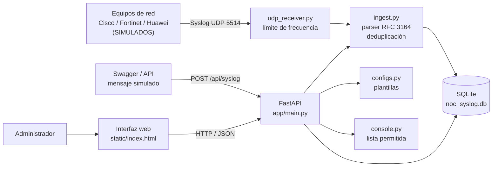
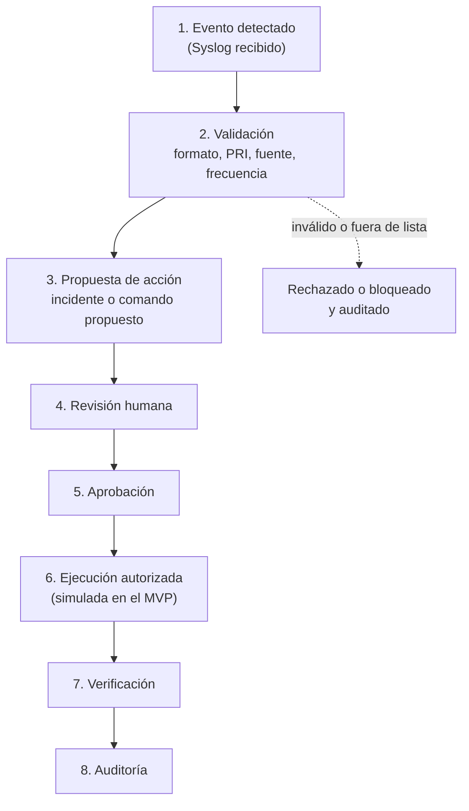
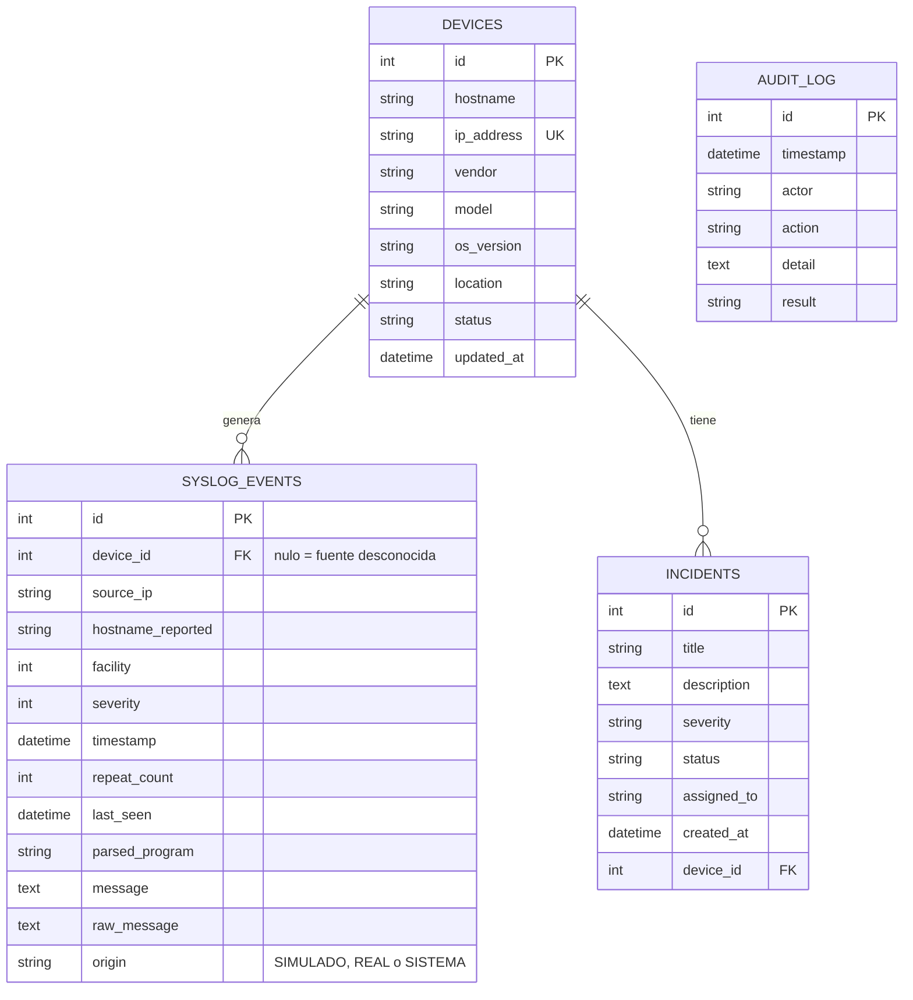

# Diseño de la solución · NOC Syslog Inteligente v0.2.0

Proyecto académico individual · Administración y Gestión de Redes · Periodo 2026-2
Docente: Ing. John Harold Pérez Calderón · Estudiante: Mauricio Ramirez

> Todos los datos del MVP son **SIMULADOS**. No se usan equipos, IPs ni credenciales de producción.

## 1. Planteamiento del problema

En una red con routers, switches y firewalls de varios fabricantes, cada equipo genera cientos de mensajes Syslog. Sin centralización, el administrador no sabe qué equipo falló, el volumen de mensajes oculta los eventos graves, no queda registro de quién atendió cada falla y no hay control sobre qué comandos se proponen o ejecutan. Además, los agentes de IA que operan sobre la red pueden ejecutar acciones no autorizadas, y los logs que reciben son datos que un atacante puede manipular.

La aplicación centraliza los eventos Syslog, los clasifica, los vincula a un inventario, los convierte en incidentes con responsable y deja auditoría de cada acción.

## 2. Objetivos

**General.** Desarrollar un MVP de NOC que reciba, clasifique y gestione eventos Syslog de equipos Cisco, Fortinet y Huawei, aplicando controles de ciberseguridad frente a acciones no autorizadas de agentes de IA.

**Específicos.**

1. Mantener un inventario editable de equipos con fecha de actualización.
2. Recibir mensajes Syslog (RFC 3164) por UDP y por API, y clasificarlos por equipo, fabricante, fecha, facility y severidad (0 a 7).
3. Mostrar un dashboard con estado, eventos recientes, críticos e incidentes, con filtros.
4. Gestionar incidentes: crear, asignar, dar seguimiento y cerrar.
5. Generar plantillas Syslog comentadas para Cisco, Fortinet y Huawei.
6. Ofrecer una consola simulada de solo lectura con lista permitida de comandos.
7. Aplicar controles iniciales: logs como datos no confiables, deduplicación, límite de frecuencia, fuente desconocida y auditoría.

## 3. Alcance y limitaciones

**Incluido en v0.2.0:** inventario, receptor UDP, API de ingesta simulada, parser RFC 3164, deduplicación, control de tormentas, dashboard con filtros, incidentes, plantillas, consola simulada y auditoría.

**No incluido (Corte 3):** alertas por Telegram, SSH real mediante backend autorizado, autenticación y roles, transporte seguro TLS (RFC 5425), formato RFC 5424, migraciones de base de datos y despliegue.

**Limitaciones conocidas**

- Sin autenticación: la auditoría usa un actor fijo.
- UDP no garantiza entrega y permite falsificar la IP de origen.
- El límite de frecuencia vive en memoria del receptor y se reinicia con él.
- La salida de la consola es texto fijo y no refleja el inventario.
- Las plantillas deben verificarse contra la guía del fabricante y probarse en laboratorio.

## 4. Requisitos

### Funcionales

| ID | Requisito | Prioridad |
|---|---|---|
| RF-01 | CRUD de equipos: nombre, IP única, marca, modelo, versión, ubicación, estado y fecha de actualización | Alta |
| RF-02 | Recibir Syslog por UDP (puerto 5514) y por API, claramente identificados como REAL o SIMULADO | Alta |
| RF-03 | Decodificar PRI en facility (0 a 23) y severidad (0 a 7) y rechazar mensajes inválidos | Alta |
| RF-04 | Vincular cada evento al equipo por IP de origen; si no está en el inventario, guardarlo como fuente desconocida | Alta |
| RF-05 | Dashboard con estado de equipos, eventos recientes, críticos e incidentes | Alta |
| RF-06 | Filtros por fecha, marca, equipo y severidad | Alta |
| RF-07 | Incidentes: crear, asignar, seguimiento de estado y cierre | Alta |
| RF-08 | Plantillas Syslog comentadas para Cisco, Fortinet y Huawei | Media |
| RF-09 | Consola simulada de solo lectura con lista permitida; bloquear todo lo demás | Media |
| RF-10 | Auditoría de inventario, incidentes y comandos | Alta |
| RF-11 | Agrupar mensajes repetidos y limitar tormentas de eventos por fuente | Media |

### No funcionales

| ID | Requisito |
|---|---|
| RNF-01 | Los logs son datos no confiables: se extraen campos y se muestran como texto, nunca como HTML ni como instrucciones |
| RNF-02 | Sin contraseñas, tokens ni IPs reales en el código ni en el repositorio |
| RNF-03 | Marcas de tiempo en UTC; la interfaz las muestra en hora de Bogotá |
| RNF-04 | Código comentado y reproducible a partir del README |
| RNF-05 | Denegar por defecto: lo que no está en la lista permitida se bloquea |

## 5. Historias de usuario

| ID | Historia | Criterios de aceptación |
|---|---|---|
| HU-01 | Como administrador quiero registrar y editar equipos para tener un inventario confiable | Se pueden crear, editar y eliminar equipos. La IP duplicada se rechaza con error 400. La fecha de actualización cambia al editar |
| HU-02 | Como operador quiero recibir mensajes Syslog por la red para centralizar los eventos | Un mensaje enviado por UDP al puerto 5514 aparece en el dashboard con su facility y severidad |
| HU-03 | Como operador quiero que un mensaje de un equipo no registrado se guarde y se distinga | El evento se guarda con equipo "DESCONOCIDO" y se cuenta en la tarjeta de fuente desconocida |
| HU-04 | Como operador quiero filtrar eventos por fecha, marca, equipo y severidad para encontrar fallas rápido | Cada filtro reduce la tabla. La opción "o más grave" incluye severidades menores o iguales |
| HU-05 | Como operador quiero convertir un evento en incidente para dar seguimiento | Desde un evento se crea un incidente vinculado al equipo, con severidad derivada |
| HU-06 | Como supervisor quiero asignar y cerrar incidentes para saber quién los atiende | El incidente cambia de Abierto a En Progreso y a Cerrado, con responsable visible |
| HU-07 | Como ingeniero quiero plantillas Syslog comentadas para configurar equipos de cada fabricante | Existen las tres plantillas, con NTP, destino, nivel y facility, y con comentarios |
| HU-08 | Como administrador quiero una consola de solo lectura para consultar sin riesgo de modificar | Los comandos permitidos responden. Un comando de modificación se bloquea y queda auditado |
| HU-09 | Como responsable de seguridad quiero que una inundación de mensajes no sature el sistema | Mensajes idénticos se agrupan con contador. Más de 100 mensajes en 60 s de una IP generan una sola alerta |
| HU-10 | Como auditor quiero ver quién hizo qué y con qué resultado | La pestaña Auditoría lista acciones con fecha, actor, detalle y resultado |

## 6. Arquitectura

## 7. Flujo seguro de acciones

Todo cambio sobre un equipo debe seguir este flujo. En el MVP la ejecución es solo simulada.

| Paso | Estado en v0.2.0 |
|---|---|
| Evento detectado | Implementado (receptor UDP y API) |
| Validación | Implementado (parser, rango de PRI, fuente desconocida, deduplicación, límite de frecuencia, lista permitida) |
| Propuesta de acción | Parcial (incidente creado desde el evento) |
| Revisión humana y aprobación | Parcial (el operador cambia el estado del incidente; sin roles) |
| Ejecución autorizada | Simulada (consola de solo lectura) |
| Verificación | Manual |
| Auditoría | Implementado (tabla `audit_log`) |

**Regla de oro:** los logs son datos no confiables. Un mensaje nunca se interpreta como instrucción para la IA ni para el sistema.

## 8. Modelo de datos

`device_id` es nulo en `SYSLOG_EVENTS` a propósito: un equipo no registrado que envía Syslog no debe perder su evento. `raw_message` conserva el mensaje original como prueba y los campos separados permiten operar. `AUDIT_LOG` no se relaciona con las demás tablas para que la auditoría sobreviva aunque se borre un equipo.

## 9. Severidades Syslog (RFC 5424)

| Valor | Nombre | Uso en el NOC |
|---|---|---|
| 0 | Emergency | Sistema inutilizable |
| 1 | Alert | Acción inmediata (también usada por la alerta de tormenta) |
| 2 | Critical | Condición crítica |
| 3 | Error | Falla que requiere atención |
| 4 | Warning | Advertencia |
| 5 | Notice | Evento normal pero significativo |
| 6 | Informational | Informativo |
| 7 | Debug | Depuración |

Valor PRI = facility × 8 + severidad. Ejemplo: `<187>` = facility 23 (local7), severidad 3 (Error).

## 10. Plantillas Syslog

Las plantillas de Cisco, Fortinet y Huawei se generan desde la pestaña **Configuraciones Syslog** (`GET /api/configs/{fabricante}`). Usan direcciones de documentación RFC 5737 (192.0.2.0/24), incluyen NTP, destino, nivel mínimo y facility, y deben verificarse con la guía oficial del fabricante antes de aplicarse.